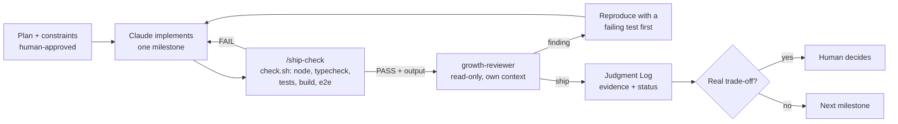

# AI-native workflow

Claude Code (Opus) did most of the implementation. The point of the setup below is that its output gets
checked by something other than itself before it counts: deterministic checks first, then an independent
read-only reviewer, then a human decision on anything that's a real trade-off. Every step is recorded in
[JUDGMENT_LOG.md](JUDGMENT_LOG.md), which is the evidence behind the examples here.

## What's in the repo

| File | Role |
|---|---|
| `CLAUDE.md` (+ `AGENTS.md`, imported) | Project contract: stack, commands, layout, product and claims rules, API/analytics/a11y/secrets rules, Judgment Log rules. Short on purpose; it points at docs instead of repeating them. |
| `DESIGN.md` | The visual system as built (tokens, type, components, rules), so later UI work extends it instead of reinventing it |
| `.claude/skills/ship-check/` | The reusable workflow. `check.sh` runs Node version, typecheck, unit tests, build and e2e in a fixed order and prints PASS/FAIL. `SKILL.md` then hands that output plus the changed files to the reviewer. |
| `.claude/agents/growth-reviewer.md` | The one committed agent: an independent reviewer with eight lenses (correctness, security, data integrity, failure modes, complexity, analytics, a11y, performance). Every finding needs `file:line` and a failure scenario. |
| `.mcp.json` | Playwright MCP, so an agent can open the page at real viewports and walk the signup flow |
| `docs/JUDGMENT_LOG.md` | Append-only log: what was delegated, what came back, what the human decided, what was rejected, and the command output that proves it |

## How the pieces work together

Rules that make the loop trustworthy:

- **The committed reviewer can't edit.** Its frontmatter allows only `Read, Grep, Glob`, with no Bash, Edit
  or Write. The checks run in the skill, and the reviewer gets their verbatim output as evidence. It was told
  to read the code, not trust the summary. (In the build session the reviews ran a little differently; see
  the notes below.)
- **A finding isn't fixed until it's reproduced.** The worst bug found (Redis returning a name `"42"` as a
  number) got a failing test before the fix.
- **The log has statuses.**
  - `approved` means the human said so explicitly.
  - `proposed` is everything else: AI-found issues and AI-made fixes, labelled with who found them (a
    reviewer, a check, Claude, or the human).

## Tools used but not committed

- **impeccable (Claude Code plugin)** for the design workflow:
  - A product interview, run as questions to the human.
  - Three page structures, from which the human chose "Hindsight vs Replay".
  - A finish review of the screenshots against the direction (five fixes, then "ship" on those fixes).
  - Generating `DESIGN.md` from the built page.
  - Its working files are gitignored. Only `DESIGN.md` is committed.
- **A second model as plan critic:** the human ran Claude's plans past an OpenAI model and pasted its
  critiques back. That cut the initial over-built architecture and added constraints like "verify, don't
  claim".
- **Vercel CLI** for linking, env vars, provisioning Upstash through the Marketplace, deploys and logs.

## Honest notes on how the setup was exercised

- **The agent and skill were created mid-session, before Claude Code loaded them.**
  - Every review in that session went to an agent type without Edit or Write that was told to follow
    `growth-reviewer.md`. That agent type does have Bash, so in that session "read-only" rested on its
    instructions, not on enforced permissions.
  - It ran `check.sh` directly, as the skill would.
  - **Verified afterwards in a fresh session** (headless `claude -p` in the project, Judgment Log row 32):
    - It listed `growth-reviewer` with tools `Read, Grep, Glob`, the `ship-check` skill, and the `playwright`
      MCP server.
    - A full `/ship-check` run then worked natively: script, then the restricted reviewer. The reviewer
      returned fix-first on that day's copy change, with two real findings.
- **Playwright MCP was configured but not loaded in the build session.** The browser work it would do
  (screenshots at 1440 and 390 px, walking the flow at 1280 and 390 px) was done with the Playwright CLI and
  test runner instead. A fresh session loads it from `.mcp.json` (confirmed in the same check).

## Who runs what

- **Primary Claude Code session:** implements, runs every command (`check.sh`, Vitest, the Playwright test
  runner, Playwright CLI screenshots, Lighthouse, deploys when approved) and is the only agent that touches
  a browser.
- **`growth-reviewer`:** reviews code and the command output it's handed. Its tools are `Read`, `Grep` and
  `Glob`, so it can't run commands, open a browser or edit anything.
- **Playwright test runner:** the e2e suite (`npm run e2e`), run by `check.sh` and by CI.
- **Playwright MCP:** configured in `.mcp.json` and confirmed loadable in a fresh session (Judgment Log
  row 32). It wasn't used in the build session; browser checks there went through the test runner and the
  Playwright CLI.

## MCP: what's connected, and what production would add

| MCP | Status | Why | How the agents would use it |
|---|---|---|---|
| **Playwright** | Configured | Visual and behavioural checks at real viewports, which a code-only reviewer can't do | The primary Claude Code session opens the page at 390/1280, fills the form and reads `window.dataLayer`. The restricted reviewer can't: it has no browser tools |
| **GA4 (Google Analytics data)** | Proposed | Experiment readouts and funnel monitoring need real data | An analysis agent pulls the funnel by variant, runs the SRM check and the decision rules from EXPERIMENT.md, and drafts the readout for a human to sign |
| **Vercel** | Proposed | Deployments, logs, env | An agent given read-only Vercel MCP access checks preview deploys and function logs (5xx, `STORE_UNAVAILABLE`, honeypot rate) without someone copying them over |
| **Convert** (via its API) | Proposed | Experiment config lives there | Read-only access, so an agent can verify a live experiment matches EXPERIMENT.md (split, goals, targeting) before launch |

Access would be read-only by default. Anything that changes production config (starting an experiment,
editing env vars) stays a human action.

## Who did what

| Delegated to Claude | Decided or done by the human |
|---|---|
| All code: API, store, form, page, analytics, tests | Product constraints: retail audience, verified-claims-only, the 1M+ claim rule, static SVG over screenshots |
| Running checks, reviews, screenshots, Lighthouse, deploy commands | Page structure: chose "Hindsight vs Replay" from three options |
| Diagnosing failures (Astro's agent-background mode, flaky hydration waits, a mobile tap bug) | Trade-offs: kept zod shared on the client after seeing the measured cost |
| Drafting every doc, including this one | Scope control: the time box, one skill, one agent, no extra infrastructure, plan reviewed against a second model |
| Writing proposed Judgment Log rows | Credentials and dashboards: Vercel login, accepting Upstash's Marketplace terms |

## Where AI improved execution

Real cases, with their log rows:

- **Redis deserialization bug (#2).** Upstash's client JSON-parses hash fields, so a user named `"42"` would
  read back as a number. The reviewer traced it in the client's source. Fixed by storing one JSON document
  per user, with a regression test.
- **PII leak before hydration (#12).** A native form submit before React took over would have put the email
  in the URL, browser history and request logs. Fixed by disabling submit until hydration, with an e2e
  check on the served HTML.
- **End-to-end PII leak through GA4 (#17, #18, #20).** Dropping email-looking UTMs only cleaned our own
  events. GA4's `page_location` would still send the full URL. Now the URL is scrubbed before GTM loads.
  Claude's manual check then caught that its own scrub skipped every other parameter, and a regression
  test pins it.
- **Mobile tap bug (#16).** An e2e failure on mobile only. Clearing a validation message on blur shifted the
  layout under the finger, so the tap missed the submit button.
- **Accessibility below the axe line (#12).** Input borders were 1.8:1 against a 3:1 requirement that axe
  doesn't test.

## Where AI output was corrected or rejected

- **The first architecture was too big.** Next.js, three agents, two skills, repository/adapter layers,
  edge A/B. The human's cross-model review cut it to one skill and one agent on Astro.
- **Claude reversed its own concession (#4).** It first agreed that "atomic isn't rollback" made the Lua
  script unsafe, then re-examined: the proposed alternative opened a race window the script didn't have.
  The script stayed, with its real limits documented.
- **Reviewer suggestions rejected:**
  - Partly #4: the key-type check stayed, because the human asked for it.
  - #15: dropping zod from the client. The human approved keeping it.
- **Claude's own mistakes, caught by checks:**
  - A pagination test that fed a `null` cursor back in.
  - An env-var command that could have stored an empty secret.
  - Shell-quoting errors that looked like API bugs in production checks.
  - A test that waited on the wrong hydration signal.

  Each one is logged as Claude's error, not the app's.

## How AI work was validated

- **Every claim in the docs traces to a command run in the session:** test counts, Lighthouse numbers,
  production API checks, the bundle sizes, the secrets scan.
- **Proxy tests weren't treated as production.** The Redis contract tests ran against Redis 7 behind a
  proxy. Production was verified separately against real Upstash, including concurrency and persistence
  across a redeploy.
- **GA4 delivery is stated as unverified,** because it is.
