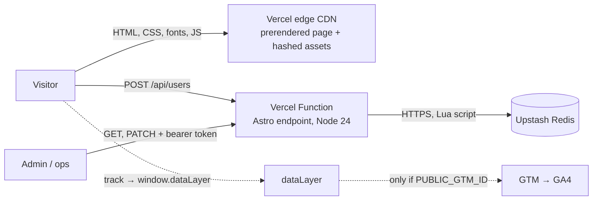

# Architecture

Live at https://fx-replay-growth.vercel.app. One Astro project deployed to Vercel: a static landing page, one
React island for the signup form, and a small Users API backed by Upstash Redis.



## Structure

```
src/pages/index.astro          the landing, prerendered at build time
src/pages/api/users/index.ts   POST (public signup), GET (admin list)
src/pages/api/users/[id].ts    PATCH (admin update)
src/components/SignupForm.tsx  the only client JS: form states, validation, analytics calls
src/components/ReplayDiptych.astro  hero illustration, SVG computed at build time, no JS
src/lib/user-schema.ts         zod schema shared by the form and the API
src/lib/users-store.ts         create / update / list, memory or Redis
src/lib/api.ts                 JSON + error helpers, admin check, body limit
src/lib/analytics.ts           typed event map + track()
src/styles/tokens.css          Brand Kit tokens (regenerated, see DESIGN.md)
tests/                         Vitest (API + store contract), Playwright e2e (journeys, analytics, a11y, GTM)
```

There are no service or repository layers. Route handlers validate, call the store, and shape the response.
The store has three functions behind one interface, because it really does have two implementations
(memory for dev and tests, Redis in production).

## Major decisions and trade-offs

| Decision | Why | Trade-off |
|---|---|---|
| Astro, static by default, plus one React island | It's a content page with one interactive part, so ship HTML and hydrate only the form. FX Replay's stack per the job description. | React's runtime is most of the JS (~66 KB gzip). Preact compat would cut it. |
| API inside the same Astro project | Same origin (no CORS), one deploy, shared types and schema | API and page scale and deploy together. Fine at this size. |
| One zod schema for form and API | One validation contract, so client and server can't drift | ~25 KB gzip in the island. Human-approved, flagged for measurement. |
| Upstash Redis via Vercel Marketplace | Durable across serverless instances, HTTP (no connection pooling), atomic scripts for email uniqueness, one-click provisioning | No ad-hoc queries. A real system would use Postgres. |
| Single-step signup, email + name | Fewest fields that still create a useful account. PATCH exists for later profile updates. | Name is optional for the business; the experiment tests dropping it. |
| GET and PATCH behind an admin token | No sessions in scope, so a public PATCH would let anyone edit anyone | Users can't edit themselves; that waits for real auth. |
| Typed events to `dataLayer`, GTM optional | Analytics part of the product from day one, and vendor-neutral at the code level | GA4 delivery unverified without a container. |
| Static SVG illustration, no screenshots | No product screenshots were provided. Zero JS and zero image weight keep LCP fast. | It's an illustration, labelled as such, not the product UI. |

## Assumptions

- **Simulated signup:** a "free account" here is a record in our store. Real FX Replay auth was out of scope.
- **Verified claims only:** no testimonials, ratings or results were provided, so the page uses one public
  claim (over 1 million traders, from fxreplay.com).
- **Brand Kit:** its `tokens/` and `source/` folders were missing, so the tokens were regenerated from the
  data embedded in `brand-kit.html` (44 primitives and 60 semantic tokens, matching the kit's README).

## Users API

| Method | Path | Auth | Success | Errors |
|---|---|---|---|---|
| POST | `/api/users` | public | 201 `{ user }` | 400 `VALIDATION` / `INVALID_JSON`, 409 `EMAIL_TAKEN`, 413, 503 `STORE_UNAVAILABLE` |
| PATCH | `/api/users/:id` | admin bearer | 200 `{ user }` | 400 `VALIDATION` / `INVALID_JSON`, 401, 404 `NOT_FOUND`, 413, 503 |
| GET | `/api/users?cursor=&limit=` | admin bearer | 200 `{ users, nextCursor }` | 400, 401, 503 |

Every error is `{ error: { code, message, fields? } }`. `fields` maps a field name to the message the form shows.

- One zod schema (`src/lib/user-schema.ts`) validates both the form and the API.
- Email is trimmed and lowercased before anything else. It's the identity key, so PATCH can only change `name`.
- Bodies over 4 KB get a 413 before parsing.
- Responses carry `cache-control: no-store`.

### Security model (intentionally limited)

There are no user sessions, since the challenge rules out building auth. So:

- **POST is public.** It's the signup.
- **GET and PATCH need `ADMIN_TOKEN`** as a bearer token, compared in constant time. If no token is configured
  they always return 401 (fail closed). Without sessions, a public PATCH would let anyone edit anyone.
- **Not done, would be next:** rate limiting and bot protection on POST, and real
  user-scoped auth so people can edit their own profile.
- **Logs never include the request payload,** so no emails end up in function logs.

### Persistence

**Upstash Redis in deployed environments, an in-memory `Map` in dev and tests.**

- **Why not memory in production:** on Vercel each function instance has its own memory and instances come
  and go. A user created on one instance wouldn't show up in a list served by another, and everything is
  lost on a cold start. A file doesn't work either, because the function filesystem is read-only and
  ephemeral.
- **Why Upstash:** it's provisioned from the Vercel Marketplace and works over HTTP, so there's no
  connection pool to manage from serverless functions. There's no schema to migrate, and it supports
  scripts, which is what makes email uniqueness atomic.
- **No silent fallback:** a deployed environment without Redis credentials returns 503 and logs it. It
  doesn't quietly switch to memory.
- **Trade-off:** no ad-hoc querying. For a real FX Replay system this would live in Postgres next to the
  rest of the account data.

Keys: `user:{id}` (the user as one JSON document), `email:{email}` → id, and `users` (sorted set scored by an
`INCR` counter, so the order is strictly by insertion no matter which instance's clock created the user). The
user is stored as JSON rather than a hash because Upstash's client JSON-parses values on read, and a hash field
like `name: "42"` would come back as the number 42. That was caught in review and is covered by a test.

### Consistency

**What's guaranteed**

- **Email uniqueness under concurrent signups.** Create runs as one Lua script that checks `email:{email}`
  and writes in the same atomic step. Two requests for the same email can't both pass the check. Tested
  with 20 concurrent creates against a real Redis 7.
- **Checks before any write.** The email is free and `users` is either missing or a sorted set. `INCR` runs
  next because it fails without side effects on a bad counter. If any of these fail, nothing is written
  (tested with a wrong-typed `users` key).

**What's not guaranteed**

- **Redis doesn't roll back scripts.** If a command fails after an earlier one already wrote (for example a
  memory limit or a provider-side error), the earlier writes stay. Writes are ordered so leftovers are the
  least harmful possible:
  1. `SET user:{id}`. If only this landed, the document is an orphan: it's not in the list and the email is
     still free, so a retry works. (A failed run may also leave a gap in the counter, which is harmless.)
  2. `SET email:{email}`. If the script stops here, the email is reserved but the user isn't listed, and a
     retry gets a 409. This is detectable by reconciling `email:*` against `users`.
  3. `ZADD users`.
- **A lost response is ambiguous.** If the script ran but the response never reached the client, the retry
  gets a 409 and the UI says the email has already signed up. That's acceptable for a signup, and there are
  no idempotency keys.
- **PATCH is last-write-wins.** It reads then writes, which is safe only because there's no delete endpoint.
- **Pagination uses offsets,** oldest first. That's stable because inserts only append (counter score)
  and there are no deletes. Adding delete would mean switching to score-based cursors.
- **Verified in two places:** the store contract tests run against Redis 7 behind an Upstash-compatible
  REST proxy. The deployed API was then checked against real Upstash: 10 concurrent POSTs with the same
  email gave 1×201 and 9×409, and data survived a redeploy.

## Deployment architecture

- **Vercel project** `fx-replay-growth`, built with `@astrojs/vercel`.
  - `/` and assets are static files on Vercel's CDN.
  - `/api/users*` are Node 24 functions.
- **Upstash Redis** is provisioned through the Vercel Marketplace. It injects `KV_REST_API_URL` and
  `KV_REST_API_TOKEN`, which the store reads (it also accepts `UPSTASH_REDIS_REST_*`).
- **Known gap:** the Upstash database is connected to production, preview and development, so preview
  deploys write to the production store. A real setup would give previews their own database.
- **Environment variables:**
  - `ADMIN_TOKEN`: Secret, production and preview.
  - `PUBLIC_GTM_ID`, `SITE_URL`, `PUBLIC_INDEXABLE`: optional, documented in `.env.example`.
- **Local:** `npm run dev` needs no env vars; the store uses memory.

## Infrastructure

How I'd run this for real, with what exists today marked.

- **Hosting:** Vercel. The page is static and the API is three small functions. There's no server to manage.
- **Deployment:**
  - **Target:** Git-based. Every PR gets a preview URL; merging to `main` promotes to production. Rollback
    is Vercel's instant rollback to the previous build.
  - **Today:** deployed with `vercel deploy --prod` from the CLI. The GitHub repo isn't connected yet.
- **CI/CD:** `.github/workflows/ci.yml` runs the same checks as `/ship-check`: typecheck, unit tests, build
  and e2e. Vercel's checks gate the merge. It hasn't run yet, because no remote exists.
  - **Next:** a JS budget check, and the e2e suite against each preview URL (`E2E_BASE_URL`).
- **DNS:** a subdomain like `try.fxreplay.com` (CNAME to Vercel) keeps the experiment isolated from the main
  site. If it has to live under `fxreplay.com/try`, a rewrite from the main site's edge to this project
  does it without moving DNS.
- **CDN / edge:** static HTML and hashed assets come from the edge. Assignment for experiments belongs at
  the edge too (Routing Middleware), so the HTML is already the right variant (see EXPERIMENT.md).
- **Caching:**
  - Hashed assets are immutable.
  - HTML uses `max-age=0, must-revalidate` at the browser and is cached at the edge until the next deploy.
  - The API is `no-store`. Nothing about a user is cacheable.
  - **Observed in production:**
    - HTML: `cache-control: public, max-age=0, must-revalidate`, with `x-vercel-cache` HIT on a repeat
      request and MISS right after a deploy.
    - Assets: `public, max-age=31536000, immutable`.
- **Observability:**
  - **Today:** Vercel function logs. Request payloads are never logged, so submitted emails and names don't
    reach them. Store failures log `STORE_UNAVAILABLE` and
    honeypot hits log `honeypot triggered`, so both can be counted.
  - **Next:** alerts on the POST 5xx rate and on `STORE_UNAVAILABLE`, Speed Insights for field CWV, and the
    daily `sign_up` against store reconciliation from ANALYTICS.md.
- **Security:**
  - Server-side validation of every input, 4 KB body limit.
  - Admin endpoints fail closed, with a constant-time token check.
  - Secrets live only in Vercel env vars; none reach client bundles (checked against the deployed assets).
  - Logs never include request payloads. Analytics events never carry form values, UTMs are kept only if
    they're campaign slugs, and known contact parameters plus email-like values are scrubbed from the URL
    before GTM. That's a format filter, not full PII detection: see the limits in
    [ANALYTICS.md](ANALYTICS.md#data-quality).
  - **Next:** rate limiting on POST (Vercel Firewall rule or `@upstash/ratelimit`), a CSP, and real auth
    replacing the admin token.
- **Reliability:**
  - The page has no runtime dependency; it's static.
  - The API depends on Upstash. Its failures return a retryable 503, and the form keeps what was typed and
    offers a retry.
  - The client has a 10 s timeout.
  - **Known gap:** no idempotency keys, so a lost response turns into a 409 on retry.

## If this became a production FX Replay system

1. **Create real accounts** in FX Replay's auth system (or call its signup API) instead of a separate store,
   with email verification. This page would only own the experience and the instrumentation.
2. **Postgres** (or whatever the account system uses) instead of Redis, with a unique index on email and
   idempotency keys on create.
3. **Rate limiting and bot protection** (Vercel Firewall or Turnstile), replacing the honeypot as the main
   defence.
4. **Consent Mode v2**, plus a server-side `sign_up` through the GA4 Measurement Protocol, deduplicated by
   `user_id`, so ad blockers and consent don't hide conversions.
5. **Experiment assignment at the edge** with the experimentation platform's SDK, and the variant in every
   event.
6. **Preact compat** (or a smaller island) to bring the JS budget down, with a CI budget check.
7. **Copy in a CMS**, so marketing can iterate on headlines without deploys. Also an OG image and
   indexing turned on.
